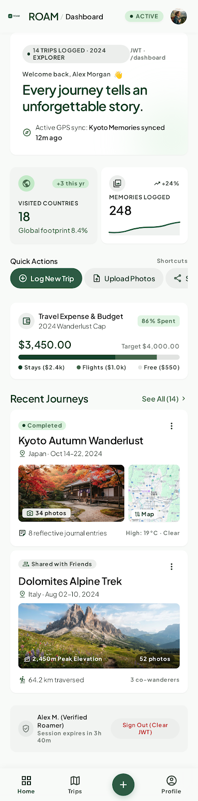

# TripVault 🗺️

A full-stack travel memory journal built with the MERN stack. TripVault lets travelers create and manage trips, upload photos to Cloudinary, and share public traveler profiles.

> **Week 4 deployment status:** The repository is prepared for Render (API) and Vercel (frontend). Add your real deployed URLs below after completing the platform setup and end-to-end verification. No live URL is claimed until you deploy it.

## Live application

- **Frontend (Vercel):** `ADD_YOUR_VERCEL_URL_HERE`
- **Backend health (Render):** `ADD_YOUR_RENDER_URL_HERE/api/health`
- **GitHub repository:** `ADD_YOUR_PUBLIC_GITHUB_REPOSITORY_URL_HERE`

## Preview

The image below is the supplied dashboard UI reference. Before final submission, replace it with a fresh screenshot or short GIF of the running/deployed TripVault app at `docs/tripvault-preview.png`.



## Features

### Authentication
- Register and sign in with bcrypt-hashed passwords.
- JWT-based sessions and protected routes.
- A private dashboard for each signed-in user.

### Trip management
- Create, read, update, and delete travel trips.
- Store title, destination, travel dates, notes, rating, and owner reference.
- Enforce ownership checks for trip reads, updates, deletes, and uploads.

### Photo uploads
- Upload JPG, PNG, and WEBP photos to Cloudinary.
- Display a trip cover image and photo gallery.
- Limit image uploads to 5 MB per image.

### Public profiles
- Unique public usernames and editable profile bios.
- Shareable `/profile/:username` pages accessible without signing in.
- Public API responses expose safe profile and trip-summary fields only; email and password are never returned.

### Week 4 user experience
- Loading feedback, readable API error states, and empty states.
- Success/error toast notifications for authentication and trip/photo actions.
- Responsive layout for desktop, tablet, and mobile screens.
- Collapsible dashboard navigation on mobile.
- Shared footer with project author and GitHub profile link.

## Tech stack

- **Frontend:** React 18, Vite, React Router, Axios, Lucide icons, CSS Grid/Flexbox.
- **Backend:** Node.js, Express, Mongoose, JWT, bcryptjs.
- **Database:** MongoDB Atlas.
- **Media storage:** Cloudinary, Multer, multer-storage-cloudinary.
- **Deployment:** Render (Express API) and Vercel (React frontend).

## Run locally

### Requirements

- Node.js 20 LTS recommended (Node 18.18+ supported by the frontend toolchain)
- npm
- MongoDB Atlas or a local MongoDB instance
- Cloudinary account for photo uploads

### 1. Clone the repository

```bash
git clone YOUR_PUBLIC_GITHUB_REPOSITORY_URL
cd tripvault
```

### 2. Install dependencies

```bash
npm install
npm run install:all
```

### 3. Configure environment variables

Copy the example files:

```powershell
Copy-Item server/.env.example server/.env
Copy-Item client/.env.example client/.env
```

Configure `server/.env`:

```dotenv
PORT=5000
MONGO_URI=your_mongodb_connection_string
JWT_SECRET=your_random_secret_at_least_32_characters
JWT_EXPIRES_IN=7d
CLIENT_URL=http://localhost:5173
CLOUDINARY_CLOUD_NAME=your_cloud_name
CLOUDINARY_API_KEY=your_api_key
CLOUDINARY_API_SECRET=your_api_secret
```

Configure `client/.env`:

```dotenv
VITE_API_URL=http://localhost:5000
```

The API client appends `/api` automatically. Alternatively, set `VITE_API_BASE_URL` to the full API base, for example `http://localhost:5000/api`.

**Never commit `.env` files or expose Cloudinary, MongoDB, or JWT secrets.** The repository `.gitignore` excludes environment files while keeping `.env.example` templates.

### 4. Start the app

```bash
npm run dev
```

- Frontend: `http://localhost:5173`
- Backend health check: `http://localhost:5000/api/health`

### 5. Production build

```bash
npm run build
```

The Vite production output is created in `client/dist`.

## API overview

All protected endpoints require `Authorization: Bearer <JWT>`.

| Method | Endpoint | Access | Purpose |
|---|---|---|---|
| POST | `/api/auth/register` | Public | Register a traveler |
| POST | `/api/auth/login` | Public | Sign in and receive JWT |
| GET | `/api/auth/me` | Protected | Read current user |
| POST | `/api/trips` | Protected | Create a trip |
| GET | `/api/trips` | Protected | List trips owned by current user |
| GET | `/api/trips/:id` | Protected | Read an owned trip |
| PUT | `/api/trips/:id` | Protected | Update an owned trip |
| DELETE | `/api/trips/:id` | Protected | Delete an owned trip |
| POST | `/api/trips/:id/upload` | Protected | Upload a photo to an owned trip |
| GET | `/api/users/:username/profile` | Public | Read public profile and trip summaries |
| PUT | `/api/users/profile` | Protected | Update current user's username/bio |
| GET | `/api/health` | Public | API and database health status |

## Deploy to Render and Vercel

### 1. MongoDB Atlas

- Use your production database and a dedicated database user.
- Configure Atlas Network Access so the Render service can reach the cluster. The internship handout suggests allowing `0.0.0.0/0`; use that only if necessary and understand it permits network access attempts from any IP. Use a strong database password and least-privilege database user.

### 2. Deploy backend to Render

This repository includes a `render.yaml` Blueprint configuration. Or create a **Web Service** manually:

- Connect the TripVault GitHub repository.
- **Root Directory:** `server`
- **Build Command:** `npm install`
- **Start Command:** `npm start` (runs `node index.js`)
- **Health Check Path:** `/api/health`

Set these environment variables in Render's Environment tab:

| Variable | Value |
|---|---|
| `MONGO_URI` | Production MongoDB connection string |
| `JWT_SECRET` | Random secret of at least 32 characters |
| `JWT_EXPIRES_IN` | `7d` |
| `CLIENT_URL` | Exact Vercel origin, e.g. `https://your-app.vercel.app` |
| `CLOUDINARY_CLOUD_NAME` | Cloudinary cloud name |
| `CLOUDINARY_API_KEY` | Cloudinary API key |
| `CLOUDINARY_API_SECRET` | Cloudinary API secret |
| `NODE_ENV` | `production` |

Copy the deployed Render service URL, for example `https://your-api.onrender.com`.

### 3. Deploy frontend to Vercel

- Import the same GitHub repository into Vercel.
- **Root Directory:** `client`
- **Framework Preset:** Vite
- **Build Command:** `npm run build`
- **Output Directory:** `dist`
- Add `VITE_API_URL` with the Render service origin (no trailing slash), e.g. `https://your-api.onrender.com`.
- Deploy. `client/vercel.json` rewrites frontend routes to `index.html` so routes such as `/profile/:username` work on refresh.

After Vercel provides the frontend URL, return to Render and set `CLIENT_URL` to that exact origin, then redeploy/restart the backend if required.

### 4. End-to-end production test

Test against the deployed domains, not only localhost:

1. Open the Vercel URL and register a new account.
2. Sign in and confirm the dashboard loads.
3. Create a trip and verify it persists after refresh.
4. Upload an image and confirm it appears on the trip card and detail page.
5. Open the public profile link in a private/incognito window without a token.
6. Confirm the public response does not contain email or password.
7. Edit and delete a trip, then confirm the list updates.
8. Check the site at 375px mobile width and at tablet/desktop widths using Chrome DevTools device simulation.

### 5. Final GitHub and internship submission

- Add your Vercel live URL to this README and the GitHub repository description.
- Add a screenshot/GIF at `docs/tripvault-preview.png`.
- Confirm `.env` files and credentials are not committed.
- Submit both the Vercel live URL and the GitHub repository link through the Week 4 Google Form.

## Suggested final QA checklist

- [ ] Login and registration show success/error feedback.
- [ ] Dashboard, public profile, and trip detail have loading and error states.
- [ ] Empty trip/profile/photo states are friendly and clear.
- [ ] Create, edit, delete, and upload actions show toast feedback.
- [ ] Dashboard navigation collapses to a hamburger menu on small screens.
- [ ] Trip cards stack to one column on narrow phones; photo grids use one or two columns.
- [ ] Login, registration, create-trip, and edit-trip forms are usable at 375px width.
- [ ] Render health check reports `database: connected`.
- [ ] Vercel frontend communicates with the Render API.
- [ ] Full deployed flow passes end-to-end testing.

## License

Add a license if you intend to distribute this project under specific open-source terms. Otherwise, all rights are reserved by the repository owner by default.
